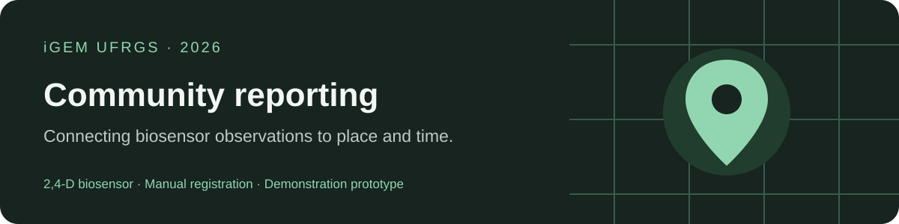
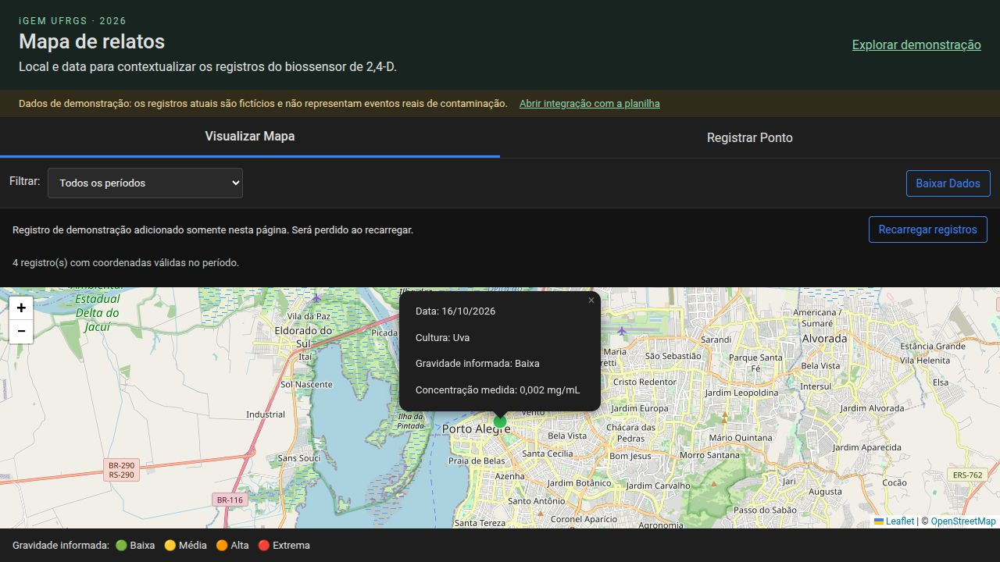
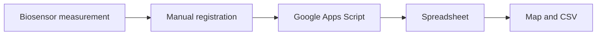

<p align="center"></p>

# iGEM UFRGS · Community reporting platform

Connect manually reported biosensor observations to the places and dates where samples were collected. Built for Brazilian farmers, with a Portuguese interface.

[Live website](https://igemufrgs2026.github.io/forum/) · [Português](README.pt-BR.md) · [Setup](docs/setup.md) · [Roadmap](docs/roadmap.md)

> **Prototype / demonstration data.** Current records are fictitious, not evidence of contamination. This source revision is local until committed and published; the live website may still show the previous version.



## From sample to shared record



There is no automatic ESP32 integration. Concentration and unit are included in new records, map details and CSV, once the v2 Apps Script is deployed. Reported severity is a user-selected category and is not calculated from a measurement.

## What works

- Interactive Leaflet map with semester filters and severity legend.
- Address lookup in Brazil, with manual coordinates as an alternative.
- Visible network and map errors, request timeouts and coordinate validation.
- Public CSV export for the selected period, ordered by date.
- Explicit local demo mode with fictitious fixtures and in-memory additions.
- Separate frontend modules and dependency-free Node tests.

## Quick start

Requires Python 3. Node.js 18+ is needed only for tests.

```sh
git clone https://github.com/igemufrgs2026/forum.git
cd forum
python3 -m http.server 8000
```

Open `http://localhost:8000/?demo=1`. Demo submissions last until reload and are never sent to Apps Script. Leaflet, map tiles and address searches still need internet; use manual coordinates to avoid address lookup. The demo is not a fully offline map.

Run checks with `npm test` (no package installation required).

## Repository guide

| Path | Purpose |
| --- | --- |
| `index.html` | Accessible Portuguese page structure |
| `assets/css/` | Responsive visual styles |
| `assets/js/` | Configuration, API, map, form, CSV and startup |
| `data/demo.json` | Fictional public fixtures |
| `backend/apps-script/` | Backend handoff and deployment requirements |
| `docs/` | Setup, architecture, data dictionary and roadmap |
| `tests/` | Regression tests |
| `.github/` | Continuous checks and contribution templates |

## Backend and current limitations

The backend supplied by the team is now revised in [Code.gs](backend/apps-script/Code.gs). It keeps the same spreadsheet, appends concentration/unit columns and exposes only public fields. Follow the [deployment instructions](backend/apps-script/README.md) before enabling live use. Frontend v2 blocks writes against an old backend to avoid losing measurement fields.

Public update/delete operations are disabled. Administration is performed by authorized editors directly in Google Sheets. Updating this repository does not update the Google deployment; old deployments must also be updated or archived. Anonymous submissions still need additional abuse protection before broader production use.

## Contributing and reuse

Read [CONTRIBUTING.md](CONTRIBUTING.md) and [security reporting](SECURITY.md). The team has not selected a software license; see [licensing status](docs/licensing.md). Open-source reuse permissions should not be inferred from repository visibility.

## Credits

Developed for iGEM UFRGS 2026. Mapping uses [Leaflet](https://leafletjs.com/), [OpenStreetMap](https://www.openstreetmap.org/copyright) and [Nominatim](https://nominatim.org/). These services have their own licenses and usage policies.
